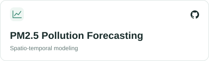
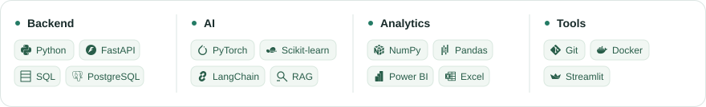
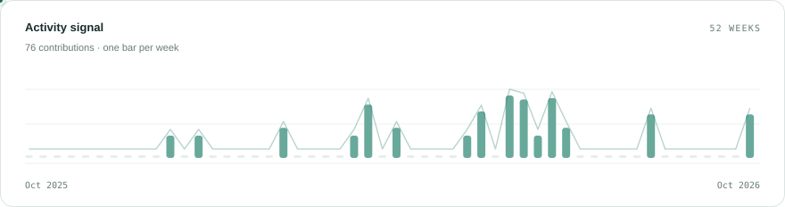

# Meet Patel

**AI/ML · Generative AI · Data**

<picture>
  <source media="(prefers-color-scheme: dark)" srcset="assets/headline-dark.svg">
  
</picture>

<!-- contacts:start -->

  <a href="https://www.linkedin.com/in/meet-patel-63b214329/"><picture><source media="(prefers-color-scheme: dark)" srcset="assets/contact-linkedin-dark.svg"></picture></a>&nbsp;&nbsp;
  <a href="mailto:meetpatel132465@gmail.com"><picture><source media="(prefers-color-scheme: dark)" srcset="assets/contact-email-dark.svg"></picture></a>

<!-- contacts:end -->

### On my radar

<!-- radar:start -->

  <picture>
    <source media="(max-width: 600px) and (prefers-color-scheme: dark)" srcset="assets/radar-vljepa-dark-mobile.svg">
    <source media="(max-width: 600px)" srcset="assets/radar-vljepa-light-mobile.svg">
    <source media="(prefers-color-scheme: dark)" srcset="assets/radar-vljepa-dark.svg">
    
  </picture>
  <a href="https://github.com/07MEET/enterprise-knowledge-copilot">
    <picture>
      <source media="(max-width: 600px) and (prefers-color-scheme: dark)" srcset="assets/radar-ekc-dark-mobile.svg">
      <source media="(max-width: 600px)" srcset="assets/radar-ekc-light-mobile.svg">
      <source media="(prefers-color-scheme: dark)" srcset="assets/radar-ekc-dark.svg">
      
    </picture>
  </a>

  <a href="https://github.com/07MEET/pm25-forecasting-system">
    <picture>
      <source media="(max-width: 600px) and (prefers-color-scheme: dark)" srcset="assets/radar-pm25-dark-mobile.svg">
      <source media="(max-width: 600px)" srcset="assets/radar-pm25-light-mobile.svg">
      <source media="(prefers-color-scheme: dark)" srcset="assets/radar-pm25-dark.svg">
      
    </picture>
  </a>
  <a href="https://github.com/07MEET/hospital-management-system">
    <picture>
      <source media="(max-width: 600px) and (prefers-color-scheme: dark)" srcset="assets/radar-hms-dark-mobile.svg">
      <source media="(max-width: 600px)" srcset="assets/radar-hms-light-mobile.svg">
      <source media="(prefers-color-scheme: dark)" srcset="assets/radar-hms-dark.svg">
      
    </picture>
  </a>

<!-- radar:end -->

### Toolbox

<picture>
  <source media="(max-width: 600px) and (prefers-color-scheme: dark)" srcset="assets/toolbox-dark-mobile.svg">
  <source media="(max-width: 600px)" srcset="assets/toolbox-light-mobile.svg">
  <source media="(prefers-color-scheme: dark)" srcset="assets/toolbox-dark.svg">
  
</picture>

### Activity

<picture>
  <source media="(prefers-color-scheme: dark)" srcset="assets/activity-dark.svg">
  <source media="(prefers-color-scheme: light)" srcset="assets/activity-light.svg">
  
</picture>

